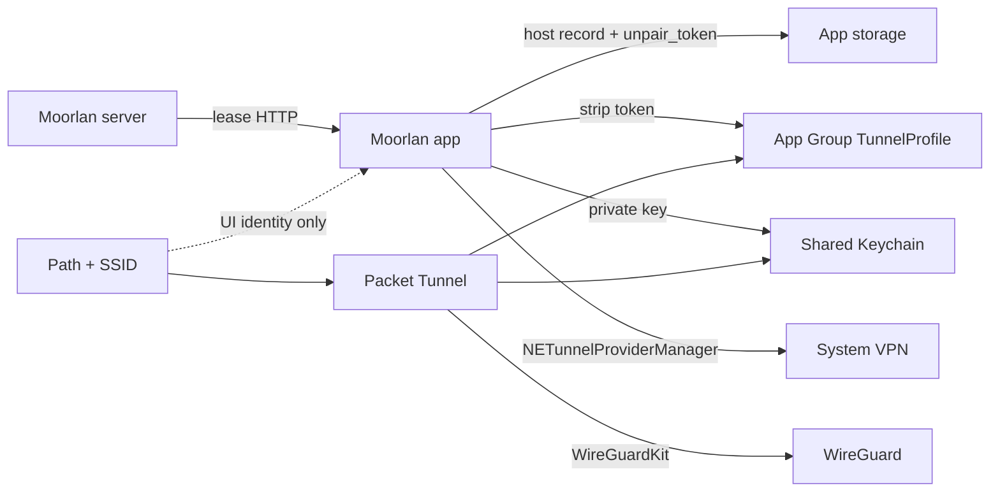

# Moorlan iOS architecture

Architecture for the iPhone / iPad app and Packet Tunnel (`ios/`). Product rules
live in [REQUIREMENTS.md](REQUIREMENTS.md); this file describes components, data
flow, and package boundaries. Protocol and lease fields match
[server/REQUIREMENTS.md](../server/REQUIREMENTS.md).

## 1. Role and boundary

- App + Packet Tunnel extension. **WireGuardKit** owns crypto, typed config, and
  the packet-tunnel adapter. Moorlan does not reimplement WireGuard or parse
  wg-quick text.
- **Multi-tunnel:** many paired hosts; one **on-demand-active** (default) tunnel
  may auto-connect. The device owns Off / Split / Full per network. Server owns
  lease identity and DNS.
- **Mac (planned):** same `moorlan://` QR via in-app camera scan; no Mac app
  target in this package map yet.

## 2. Ownership and state

| Owner | Responsibility |
| --- | --- |
| Server lease | `tunnel_network`, `home_networks`, `dns_servers`, `dns_search`, `name`, endpoint, address, keys, token |
| App storage | Host records (full lease including `unpair_token`), selection, on-demand-active id, durable routing map |
| App Group | Extension profile per host — no private key, no `unpair_token` |
| Keychain | One long-lived client WireGuard private key |
| System VPN | Per-host `NETunnelProviderManager` |
| App + extension | Path/SSID → AllowedIPs + connect/disconnect |

## 3. Package map

| Target / area | Owns |
| --- | --- |
| `Moorlan` app | SwiftUI (Home, Scanner), `onOpenURL` for `moorlan://`, `TunnelManager`, permissions UX, tunnel list / default |
| `MoorlanCore` | Lease, QR / `ScannedCode`, `PairingClient`, `TunnelPolicy`, `ServerStore`, `IdentityStore`, path/SSID helpers, errors |
| `PacketTunnel` | `NE` provider; load App Group profile; apply durable policy; WireGuardKit start/update/stop |
| `Shared` | `AppIdentity`, `WireGuardProfileBuilder` |
| `Vendor/wireguard-apple` | Vendored WireGuardKit |

Dependency direction: app and extension → MoorlanCore + Shared → WireGuardKit.
Pairing HTTP and unpair credentials stay in the app process; the extension never
reads `unpair_token`.

## 4. Critical flows

### Pair

1. System Camera (primary) or in-app fallback scans `moorlan://v1/pair?…` on
   home Wi‑Fi → reach control `url` on the LAN.
2. `POST /v1/pair` with client public key + device label.
3. Persist host + full lease (including `unpair_token`) in app storage.
4. Mark current SSID **Off** when identifiable.
5. Install `NETunnelProviderManager` for this server key.
6. Write App Group `TunnelProfile` with token stripped.
7. First/only tunnel → auto on-demand active; additional tunnels keep the
   existing default (user can change later via the star).
8. Show the tunnel list home with the new tunnel selected.

### Policy (roaming)

1. Extension observes network path + Apple Wi‑Fi identity (SSID). Unsettled →
   **Full**. Stable (named Wi‑Fi or cellular-only) → durable path policy if it
   differs. If never stable, remain Full. Missing SSID is not an error.
2. One durable map (Wi‑Fi default Full; cellular default Full). Edited from the
   tunnel-list menu on the current path; persists to app storage + App Group.
3. App launch / foreground: observe system VPN status only — do not re-save
   preferences or restart the tunnel. User policy edits, pair/unpair, and
   “Use as default” are the only app-driven VPN mutations.
4. On-demand Disconnect/Connect rules evaluate Off SSIDs. Update those rules
   only when the Off set changes.
5. Off → disconnect; Split → subnet AllowedIPs; Full → plus `0.0.0.0/0` (never
   `::/0`). DNS host routes required because WireGuardKit sends all queries to
   lease DNS.
6. On-demand only on the on-demand-active manager when ≥1 Off SSID exists.

### Unpair

1. Confirm; require Off Wi‑Fi when Off SSIDs are configured.
2. Scan unpair QR → match host by `server_public_key`.
3. `DELETE /v1/pair` with peer key + app-stored `unpair_token`.
4. On **204** only: remove that host’s VPN profile, App Group blob, and app
   host record. Keep Keychain identity and other tunnels. Repair on-demand
   default per REQUIREMENTS §4.

### VPN conflict

If another VPN (e.g. Tailscale) supersedes Moorlan, surface a plain-English
error (title + sentence + Retry). Only one VPN can be active at a time.

## 5. Storage

| Store | Content |
| --- | --- |
| App storage | Paired hosts: card, full lease (`unpair_token` included), selected id, on-demand-active id, label |
| App storage | Durable `networkRouting` + `cellularRouting` |
| App Group `group.app.moorlan` | `TunnelProfile` per host for the extension — strip `unpair_token`; no private key |
| Keychain shared group | Client WireGuard private key (`AfterFirstUnlockThisDeviceOnly`) |
| System | One `NETunnelProviderManager` per server public key |

## 6. UX architecture

- HIG-native SwiftUI (`NavigationStack`, inset grouped lists/forms, SF Symbols).
  See [REQUIREMENTS.md](REQUIREMENTS.md) §8.
- Tunnel list: quiet list (name + status pill); tap opens details. Durable
  Off/Split/Full via prominent Home path control + About Routing info sheet.
  Camera scans pair/unpair QR. No Settings screen; no prototype theme switcher /
  power button / connection diagram.
- Errors: title + one sentence + action. No raw NE / URL error strings in UI.
- Accessibility: Dynamic Type, VoiceOver, Reduce Motion.

## 7. What this architecture excludes

See [REQUIREMENTS.md](REQUIREMENTS.md) §9: no Mac app in this tree yet, no
offline unpair queue, no hairpin via CIDR, no phone-invented DNS, no foreign
config import.
