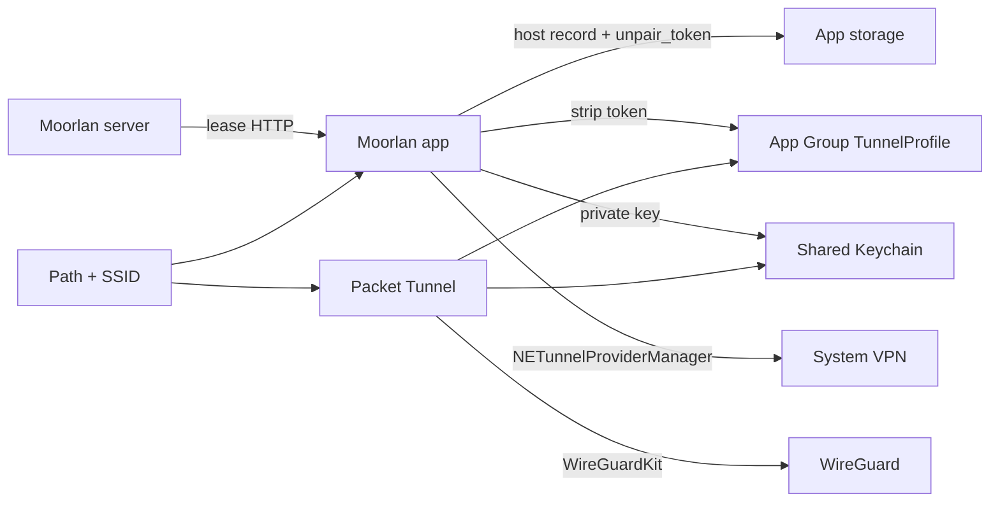

# Moorlan iPhone architecture

Architecture for the iPhone app and Packet Tunnel (`ios/`). Product rules live in
[REQUIREMENTS.md](REQUIREMENTS.md); this file describes components, data flow,
and package boundaries. Protocol and lease fields match
[server/REQUIREMENTS.md](../server/REQUIREMENTS.md).

## 1. Role and boundary

- App + Packet Tunnel extension. **WireGuardKit** owns crypto, typed config, and
  the packet-tunnel adapter. Moorlan does not reimplement WireGuard or parse
  wg-quick text.
- **Multi-tunnel:** many paired hosts; one selected tunnel drives automatic
  activation. Phone owns Home / Trusted / Away roles and routing mode. Server
  owns lease identity and DNS.

## 2. Ownership and state

| Owner | Responsibility |
| --- | --- |
| Server lease | `tunnel_network`, `home_networks`, `dns_servers`, `dns_search`, endpoint, address, keys, token |
| App storage | Host records (full lease including `unpair_token`), selection, SSID roles |
| App Group | Extension profile per host — no private key, no `unpair_token` |
| Keychain | One long-lived client WireGuard private key |
| System VPN | Per-host `NETunnelProviderManager` |
| App + extension | Path/SSID → AllowedIPs + connect/disconnect |

## 3. Package map

| Target / area | Owns |
| --- | --- |
| `Moorlan` app | SwiftUI (Home, Settings, Scanner), `TunnelManager`, permissions UX, tunnel list / selection |
| `MoorlanCore` | Lease, QR / `ScannedCode`, `PairingClient`, `TunnelPolicy`, `ServerStore`, `IdentityStore`, path/SSID helpers, errors |
| `PacketTunnel` | `NE` provider; load App Group profile; apply policy; WireGuardKit start/update/stop |
| `Shared` | `AppIdentity`, `WireGuardProfileBuilder` |
| `Vendor/wireguard-apple` | Vendored WireGuardKit |

Dependency direction: app and extension → MoorlanCore + Shared → WireGuardKit.
Pairing HTTP and unpair credentials stay in the app process; the extension never
reads `unpair_token`.

## 4. Critical flows

### Pair

1. Scan pair QR on home Wi‑Fi → reach `pair_url` on the LAN.
2. `POST /v1/pair` with client public key + device label.
3. Persist host + full lease (including `unpair_token`) in app storage.
4. Install `NETunnelProviderManager` for this server key.
5. Write App Group `TunnelProfile` with token stripped.
6. Show status home with the new tunnel selected.

### Policy (roaming)

1. Observe network path + Apple Wi‑Fi identity (SSID).
2. Automatic matrix for the **selected** tunnel:
   - Home SSID → tunnel **off** (hairpin; wins over manual exit)
   - Trusted Wi‑Fi or cellular (trusted by default) → **subnet**
   - Away / unidentified Wi‑Fi → **exit**
3. Build AllowedIPs: `tunnel_network ∪ home_networks` (+ defaults only in exit).
4. DNS/search from lease only. Apply in app and Packet Tunnel so background
   path changes still update the tunnel. On-demand when ≥1 Home SSID exists.

### Unpair

1. Confirm; require Home Wi‑Fi when Home SSIDs are configured.
2. Scan unpair QR → match host by `server_public_key`.
3. `DELETE /v1/pair` with peer key + app-stored `unpair_token`.
4. On **204** only: remove that host’s VPN profile, App Group blob, and app
   host record. Keep Keychain identity and other tunnels.

### VPN conflict

If another VPN (e.g. Tailscale) supersedes Moorlan, surface a plain-English
error (title + sentence + Retry). Only one VPN can be active at a time.

## 5. Storage

| Store | Content |
| --- | --- |
| App storage | Paired hosts: card, full lease (`unpair_token` included), Home/Trusted SSIDs, selected id, label, policy |
| App Group `group.app.moorlan` | `TunnelProfile` per host for the extension — strip `unpair_token`; no private key |
| Keychain shared group | Client WireGuard private key (`AfterFirstUnlockThisDeviceOnly`) |
| System | One `NETunnelProviderManager` per server public key |

## 6. UX architecture

- System SwiftUI grammar (SF Pro, semantic colors, `NavigationStack`, inset
  grouped lists/forms, SF Symbols). Status hero in plain English; empty state
  with Scan CTA.
- Errors: title + one sentence + action. No raw NE / URL error strings in UI.
- Settings: network roles and tunnel selection — **not** lease DNS/search or
  other lease identity overrides. Technical details behind disclosure.
- Accessibility: Dynamic Type, VoiceOver, Reduce Motion.

## 7. What this architecture excludes

See [REQUIREMENTS.md](REQUIREMENTS.md) §9: no macOS target, no offline unpair
queue, no hairpin via CIDR, no phone-invented DNS, no foreign config import.
