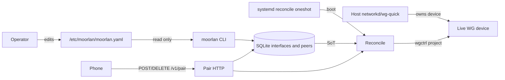
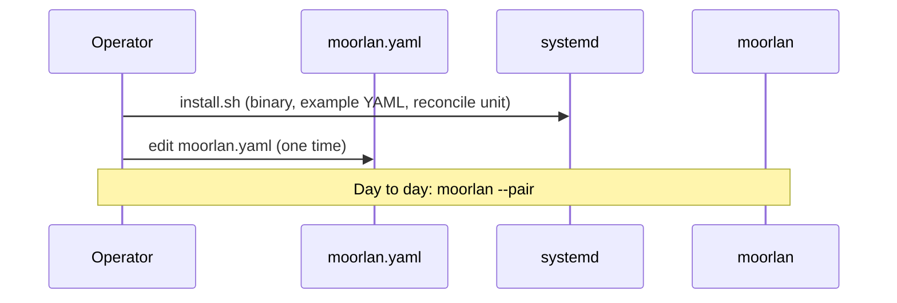

# Moorlan server architecture

Architecture for the Linux Go server (`server/`). Product rules live in
[REQUIREMENTS.md](REQUIREMENTS.md); this file describes how those rules are
structured in components, packages, and data flow.

## 1. Role and boundary

- One static binary: `/usr/local/bin/moorlan`.
- CLI modes, not a long-running control daemon. `--pair` / `--unpair` run a
  short-lived HTTP session (idle-stop 2 minutes); everything else is oneshot.
- Host (networkd / wg-quick / …) owns the WireGuard device (key, address, listen
  port, routes, firewall). Moorlan enrolls peers in SQLite and projects them live
  via wgctrl. Moorlan never writes peer entries into wg-quick or networkd config
  files.
- Trust model and non-goals: see REQUIREMENTS §§2 and 9.

## 2. Roles and state



| Artifact | Role |
| --- | --- |
| `/etc/moorlan/moorlan.yaml` | Operator-authored host + per-interface settings (SoT for those keys) |
| SQLite `interfaces` + `peers` | SoT for server keys and enrolled peers |
| Live WG via wgctrl | Projection of SQLite |
| `moorlan-reconcile.service` | Boot `--reconcile` with bounded retries; soft-fail per iface |
| `/run/moorlan-<iface>.lock` | Exclusive process lock per interface |

## 3. Package map

```
cmd/moorlan
  → settings, runtime, pair, payload, qr, systemd

runtime
  → iface, pair (Lease types), payload (labels/keys)
  → wgctrl, SQLite

pair → payload
settings, iface, qr, systemd → stdlib / embeds only
```

| Package | Owns |
| --- | --- |
| [`cmd/moorlan`](cmd/moorlan/main.go) | Mode dispatch, root check, iface flock, pair/unpair process lifecycle |
| [`internal/settings`](internal/settings) | Load/validate `/etc/moorlan/moorlan.yaml`; no site-key CLI overlay in v1 |
| [`internal/runtime`](internal/runtime) | Discover/validate host+device; SQLite `interfaces`/`peers`; Assign / Remove / Reconcile / List; unpair HMAC; lock paths |
| [`internal/iface`](internal/iface) | Tunnel pool select + deterministic `/32` allocation |
| [`internal/pair`](internal/pair) | HTTP `/v1/pair`, idle timer, `Lease` JSON shape |
| [`internal/payload`](internal/payload) | Pair/unpair QR cards; URL / key / label validation |
| [`internal/qr`](internal/qr) | Terminal QR rendering |
| [`systemd`](systemd) | Embedded oneshot → `moorlan --reconcile` |

## 4. Critical flows

### Setup



- YAML at `/etc/moorlan/moorlan.yaml` MUST already exist (hint example path if missing).
- SQLite is created or opened as needed under the configured `db` path.
- First successful use of an interface inserts `interfaces(name, server_public_key)` from the live device; that key is immutable thereafter.

### Pair

1. Resolve interface (sole YAML iface, or required `--interface`); refuse if not in YAML.
2. Lock interface; discover host; reconcile.
3. Print pair QR (`pair_url`, `server_public_key`); bind sticky root `private-endpoint`.
4. On `POST /v1/pair`: validate label/key → allocate or reuse `/32` → commit peer
   row → reconcile → return lease.
5. Lease includes `tunnel_network` (pool from live device), `home_networks`,
   required `dns_servers`, optional `dns_search`, `unpair_token`, endpoint from
   that iface’s `public-endpoint`, etc. No `prefixes` / `lan`.

### Unpair / admin remove

1. Unpair: QR identifies **server** key + URL; phone sends its pubkey + token.
2. Admin `--remove`: iface + pubkey only, no QR. Works even if iface is absent from YAML.
3. Delete `peers` row (commit) → reconcile.
4. If reconcile fails, DB already won; next reconcile or boot clears the live orphan.

### Reconcile / boot

1. Target set: explicit `--interface`, or every iface in YAML **or** still present in DB.
2. Per iface (stable lock order): ensure each DB peer is on the live device with
   correct AllowedIPs; remove every live peer absent from the DB for that iface.
3. Soft-fail per iface. No `pending_removals` journal. Boot unit runs
   `moorlan --reconcile` with a bounded restart window (~5 minutes) while devices
   are not yet usable.

## 5. Persistence

| Path | Content |
| --- | --- |
| `/etc/moorlan/moorlan.yaml` | `db`, `private-endpoint`; per-iface `public-endpoint`, `home-networks`, `dns-servers`, optional `dns-search` |
| `/usr/share/moorlan/moorlan.yaml.example` | Documented example (every key commented) |
| `/var/lib/moorlan/moorlan.db` (or `db`) | Interfaces + peers SoT |
| `/etc/systemd/system/moorlan-reconcile.service` | Boot reconcile oneshot |
| `/run/moorlan-<iface>.lock` | flock |
| `/usr/local/bin/moorlan` | Binary path used by the unit |

### SQLite

```sql
interfaces (
  name TEXT PRIMARY KEY NOT NULL,
  server_public_key TEXT NOT NULL UNIQUE
);
peers (
  interface_id TEXT NOT NULL REFERENCES interfaces(name),
  public_key TEXT NOT NULL,
  address TEXT NOT NULL,
  label TEXT NOT NULL DEFAULT '',
  PRIMARY KEY (interface_id, public_key),
  UNIQUE (interface_id, address)
);
```

No `metadata` table. No `pending_removals`. Labels may duplicate; peer identity is
`(interface_id, public_key)`.

## 6. Concurrency and failure

- Exactly one primary CLI mode per process.
- Non-blocking exclusive flock per interface; refuse concurrent mutators on the
  same iface. Host-wide `--reconcile` locks ifaces in stable name order.
- Assigner mutex serializes Assign / Remove / Reconcile per interface.
- SQLite single writer; commit peer changes before live apply.
- Live may lag DB until the next successful reconcile; DB is authoritative.
- Failed mutations are retryable. Same inputs and explicit state → predictable outcomes.

## 7. What this architecture deliberately excludes

See REQUIREMENTS §9. In particular: no peer file writes into host network
managers, no continuous pair daemon, no CLI overrides of site conf keys, no
STUN/UPnP/relays, no interface registration CLI.
