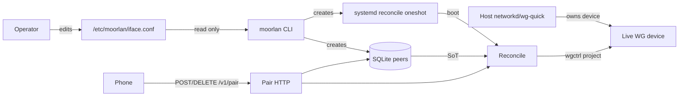
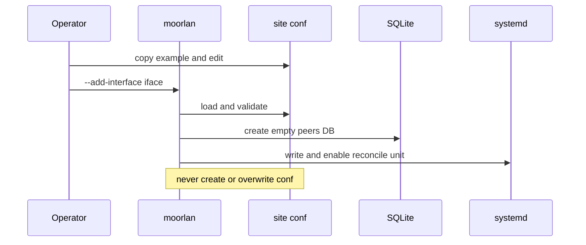

# Moorlan server architecture

Architecture for the Linux Go server (`server/`). Product rules live in
[REQUIREMENTS.md](REQUIREMENTS.md); this file describes how those rules are
structured in components, packages, and data flow.

## 1. Role and boundary

- One static binary: `/usr/local/bin/moorlan`.
- CLI modes, not a long-running control daemon. `--pair` / `--unpair` run a
  short-lived HTTP session (idle-stop 2 minutes); everything else is oneshot.
- Host (networkd / wg-quick / …) owns the WireGuard device (key, address, listen
  port, routes, firewall). After `--add-interface`, Moorlan owns **all** peers on
  that device and projects them live via wgctrl. Moorlan never writes peer
  entries into wg-quick or networkd config files.
- Trust model and non-goals: see REQUIREMENTS §§2 and 9.

## 2. Ownership and state



| Artifact | Role |
| --- | --- |
| `/etc/moorlan/<iface>.conf` | Operator-authored site settings (SoT for those keys) |
| SQLite `peers` | SoT for enrolled peers |
| Live WG via wgctrl | Projection of SQLite |
| systemd oneshot | Boot `--reconcile` with bounded retries |
| `/run/moorlan-<iface>.lock` | Exclusive process lock per interface |

## 3. Package map

```
cmd/moorlan
  → settings, runtime, pair, payload, qr, systemd

runtime
  → iface, pair (Lease types), payload (labels/keys)
  → wgctrl, SQLite

pair → payload
settings, iface, qr, systemd → stdlib / embeds only
```

| Package | Owns |
| --- | --- |
| [`cmd/moorlan`](cmd/moorlan/main.go) | Mode dispatch, root check, iface flock, add/remove-interface orchestration, pair/unpair process lifecycle |
| [`internal/settings`](internal/settings) | Load/validate canonical site conf; no site-key CLI overlay in v1 |
| [`internal/runtime`](internal/runtime) | Discover/validate host+device; SQLite `peers`; Assign / Remove / Reconcile / List; unpair HMAC; lock paths |
| [`internal/iface`](internal/iface) | Tunnel pool select + deterministic `/32` allocation |
| [`internal/pair`](internal/pair) | HTTP `/v1/pair`, idle timer, `Lease` JSON shape |
| [`internal/payload`](internal/payload) | Pair/unpair QR cards; URL / key / label validation |
| [`internal/qr`](internal/qr) | Terminal QR rendering |
| [`systemd`](systemd) | Embedded oneshot template → `moorlan --reconcile --interface <iface>` |

## 4. Critical flows

### Add-interface



- Conf at `/etc/moorlan/<iface>.conf` MUST already exist (hint example path if missing).
- Live device MUST have zero peers; DB and unit MUST NOT already exist.
- On partial failure: roll back DB and unit only — never delete or rewrite site conf.

### Pair

1. Lock interface; discover host; reconcile.
2. Print pair QR (`pair_url`, `server_public_key`); bind sticky `private-endpoint`.
3. On `POST /v1/pair`: validate label/key → allocate or reuse `/32` → commit peer
   row → reconcile → return lease.
4. Lease includes `tunnel_network` (pool from live device), `home_networks`,
   required `dns_servers`, optional `dns_search`, `unpair_token`, endpoint, etc.
   No legacy `prefixes` / `lan`.

### Unpair / admin remove

1. Unpair: QR identifies **server** key + URL; phone sends its pubkey + token.
2. Admin `--remove`: pubkey only, no QR.
3. Delete `peers` row (commit) → reconcile.
4. If reconcile fails, DB already won; next reconcile or boot clears the live orphan.

### Reconcile / boot

1. Ensure each DB peer is on the live device with correct AllowedIPs.
2. Remove every live peer absent from the DB.
3. No `pending_removals` journal. Boot unit runs the same `--reconcile` oneshot
   with a bounded restart window (~5 minutes) while the device is not yet usable.

## 5. Persistence

| Path | Content |
| --- | --- |
| `/etc/moorlan/<iface>.conf` | `interface`, `db`, `private-endpoint`, `public-endpoint`, `home-networks`, `dns-servers`, optional `dns-search` |
| `/usr/share/moorlan/moorlan.conf.example` | Documented example (every key commented) |
| `/var/lib/moorlan/<iface>.db` (or `db=`) | Peer SoT |
| `/etc/systemd/system/moorlan-reconcile-<iface>.service` | Boot reconcile oneshot |
| `/run/moorlan-<iface>.lock` | flock |
| `/usr/local/bin/moorlan` | Binary path used by the unit |

### SQLite (target)

```sql
metadata (server_key TEXT NOT NULL);  -- live WG public key at init; refuse mismatch
peers (
  public_key TEXT PRIMARY KEY,
  address    TEXT UNIQUE NOT NULL,  -- e.g. 10.8.0.2/32
  label      TEXT NOT NULL DEFAULT ''
);
```

No `pending_removals` table. Labels may duplicate; identity is public key only.

## 6. Concurrency and failure

- Exactly one primary CLI mode per process.
- Non-blocking exclusive flock per interface; refuse concurrent mutators.
- Assigner mutex serializes Assign / Remove / Reconcile.
- SQLite single writer; commit peer changes before live apply.
- Live may lag DB until the next successful reconcile; DB is authoritative.
- Failed mutations are retryable. Same inputs and explicit state → predictable outcomes.

## 7. What this architecture deliberately excludes

See REQUIREMENTS §9. In particular: no peer file writes into host network
managers, no continuous pair daemon, no CLI overrides of site conf keys, no
STUN/UPnP/relays, no adopting foreign peer DBs or live peers at add-interface.
