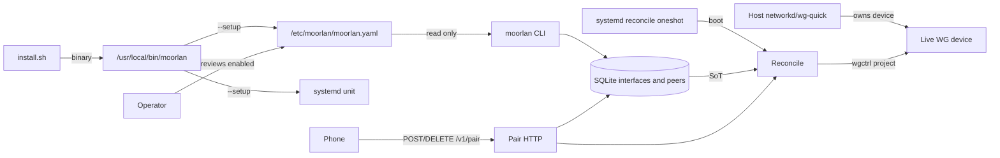
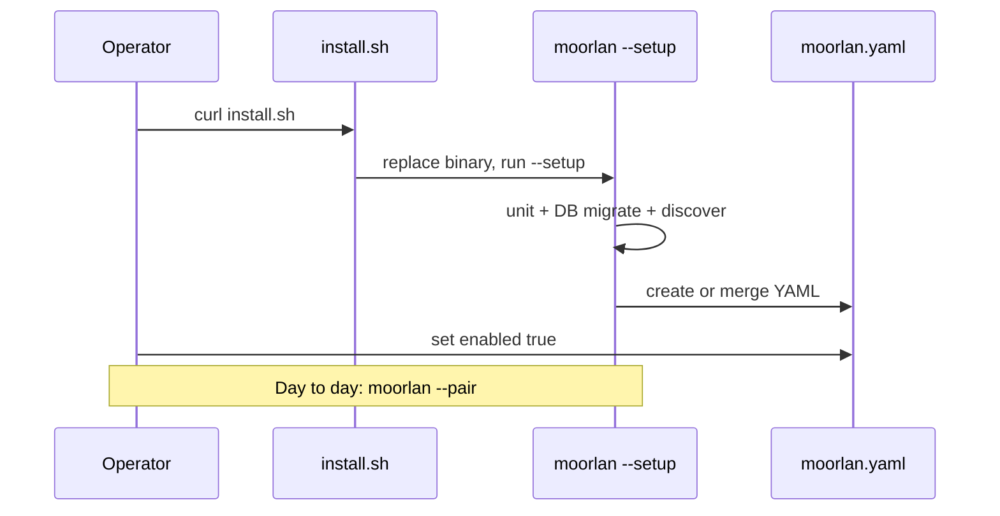

# Moorlan server architecture

Architecture for the Linux Go server (`server/`). Product rules live in
[REQUIREMENTS.md](REQUIREMENTS.md); this file describes how those rules are
structured in components, packages, and data flow.

## 1. Role and boundary

- One static binary: `/usr/local/bin/moorlan`.
- CLI modes, not a long-running control daemon. `--pair` / `--unpair` run a
  short-lived HTTP session (idle-stop 2 minutes); everything else is oneshot.
- Host (networkd / wg-quick / …) owns the WireGuard device (key, address, listen
  port, routes, firewall). Moorlan enrolls peers in SQLite and projects them live
  via wgctrl. Moorlan never writes peer entries into wg-quick or networkd config
  files.
- Trust model and non-goals: see REQUIREMENTS §§2 and 9.

## 2. Roles and state



| Artifact | Role |
| --- | --- |
| `/etc/moorlan/moorlan.yaml` | Host + per-interface settings (SoT); `enabled` gates new enroll |
| SQLite `interfaces` + `peers` | SoT for server keys and enrolled peers |
| Live WG via wgctrl | Projection of SQLite |
| `moorlan-reconcile.service` | Boot `--reconcile`; written by `--setup` from embed |
| `/run/moorlan-<iface>.lock` | Exclusive process lock per interface |

## 3. Package map

```
cmd/moorlan
  → settings, setup, runtime, pair, payload, qr, systemd

setup → settings, runtime (MigrateStore), systemd, wgctrl, stun
runtime → iface, pair (Lease types), payload, wgctrl, SQLite
```

| Package | Owns |
| --- | --- |
| [`cmd/moorlan`](cmd/moorlan/main.go) | Mode dispatch, root check, iface flock, pair/unpair lifecycle |
| [`internal/setup`](internal/setup) | `--setup`: unit install, DB migrate, discover/merge YAML |
| [`internal/settings`](internal/settings) | Load/validate/write/merge site YAML |
| [`internal/runtime`](internal/runtime) | Host+device; SQLite; Assign / Remove / Reconcile / List |
| [`internal/iface`](internal/iface) | Tunnel pool + `/32` allocation |
| [`internal/pair`](internal/pair) | HTTP `/v1/pair`, idle timer, `Lease` |
| [`internal/payload`](internal/payload) | QR cards; URL / key / label validation |
| [`internal/qr`](internal/qr) | Terminal QR rendering |
| [`systemd`](systemd) | Embedded oneshot + Install() |

## 4. Critical flows

### Install / setup



- `install.sh` is the exclusive supported install/upgrade path.
- `--setup` merges guesses with existing conf (existing set fields win).
- First successful use of an interface inserts `interfaces(name, server_public_key)`.

### Pair

1. Resolve interface among **enabled** YAML ifaces (sole enabled may omit `--interface`).
2. Lock; discover; reconcile; print QR; bind `private-endpoint`.
3. Enroll → DB → reconcile → lease.

### Unpair / admin remove

Unchanged: DB-backed revoke works if YAML iface is disabled or removed.

### Reconcile / boot

Target set: **enabled** YAML names ∪ DB names (optional `--interface` filter).

## 5. Persistence

| Path | Content |
| --- | --- |
| `/etc/moorlan/moorlan.yaml` | `private-endpoint`; per-iface `enabled`, `name`, `public-endpoint`, `home-networks`, `dns-servers`, optional `dns-search` |
| `/usr/share/moorlan/moorlan.yaml.example` | Minimal template |
| `/var/lib/moorlan/moorlan.db` | Interfaces + peers SoT |
| `/etc/systemd/system/moorlan-reconcile.service` | Boot reconcile oneshot |
| `/run/moorlan-<iface>.lock` | flock |
| `/usr/local/bin/moorlan` | Binary |

### SQLite

Same schema as REQUIREMENTS §11. Migrate on `--setup` (and whenever the DB is opened for peer ops).

## 6. Concurrency and failure

- Exactly one primary CLI mode per process.
- Non-blocking exclusive flock per interface.
- SQLite single writer; commit before live apply.
- Failed mutations are retryable.

## 7. What this architecture deliberately excludes

See REQUIREMENTS §9. In particular: no peer file writes into host network
managers, no continuous pair daemon, no CLI overrides of site conf keys, no
UPnP/relays, no interface registration CLI, no ensureHost on every day-to-day
command.
